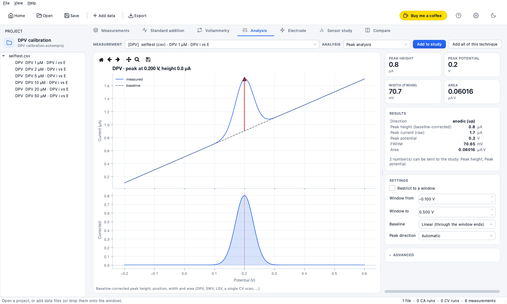
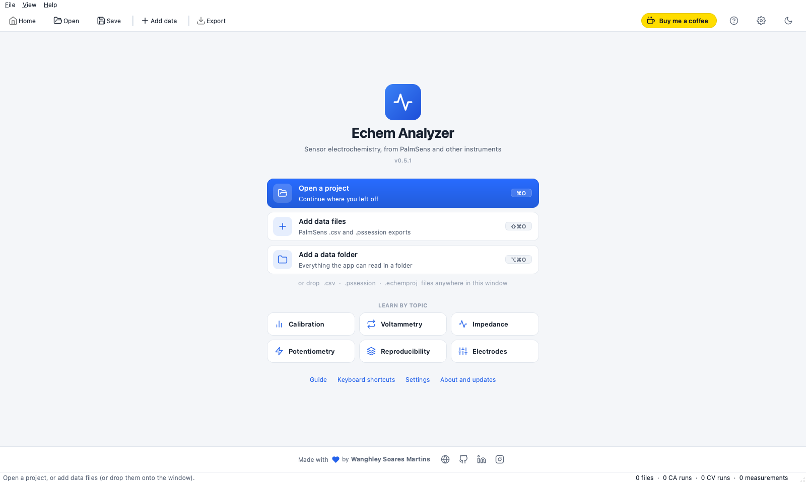
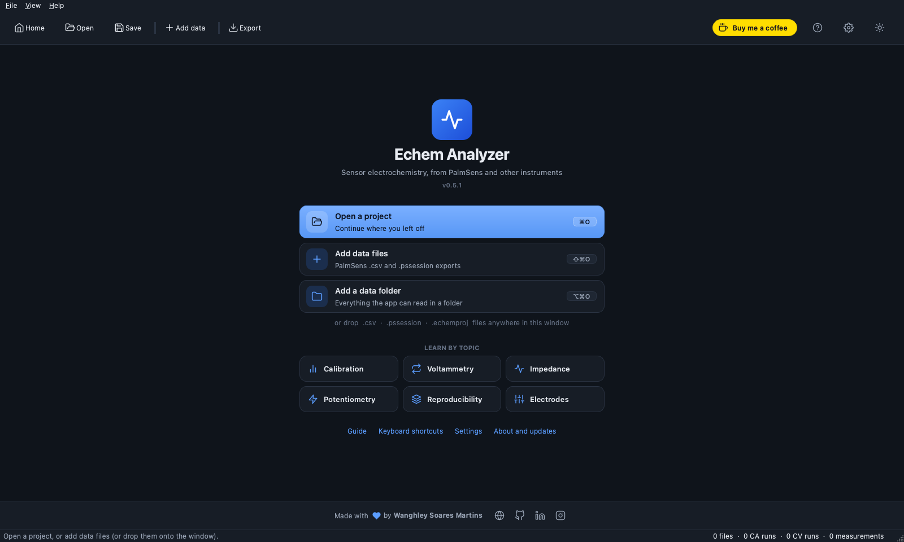
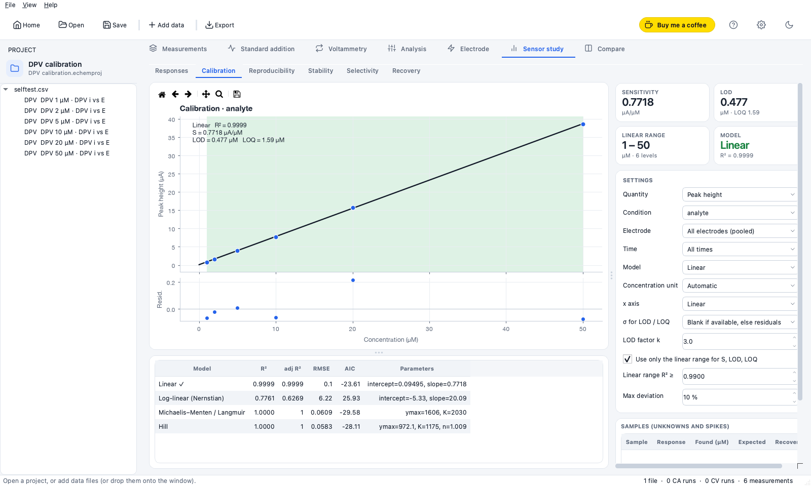
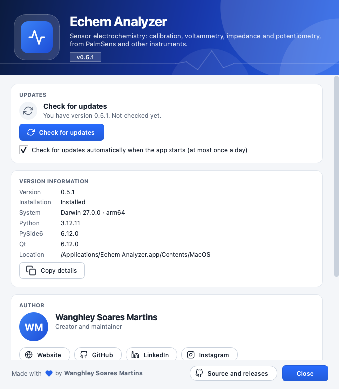

<p align="center">
  
</p>

<h1 align="center">Echem Analyzer</h1>

<div align="center">
  <strong>Sensor electrochemistry analysis for PalmSens data.</strong><br>
  From raw curves to calibration, LOD/LOQ and electrode studies, and a PDF report or Excel workbook with the data, setup, results and plots together.
</div>

<p align="center">
  <br>
  
  
  
  <a href="https://semver.org/"></a>
  <a href="CHANGELOG.md"></a>
</p>

<p align="center">
  <a href="#-install"><strong>Install</strong></a>
  ·
  <a href="docs/user-guide.md"><strong>User guide</strong></a>
  ·
  <a href="docs/analysis-methods.md"><strong>Analysis methods</strong></a>
  ·
  <a href="CHANGELOG.md"><strong>Changelog</strong></a>
  ·
  <a href="docs/development.md"><strong>Development</strong></a>
  ·
  <a href="#-support"><strong>Support</strong></a>
</p>

<p align="center">
  
  <br>
  <sub>Screenshots in this README use synthetic data.</sub>
</p>

## ✨ Highlights

- **Any PalmSens measurement.** Reads PSTrace `.csv` and `.pssession` exports (every measurement in a session, including runs never exported), and any x–y table through *Import table…*.
- **From curve to figure of merit.** Standard addition with a 95 % interval on C<sub>x</sub>, calibration with model comparison (linear, Nernstian, Michaelis–Menten, Hill), LOD/LOQ from the residual, the baseline noise or blank replicates, and a linear-range finder.
- **Whole sensor studies.** Reproducibility between electrodes, stability over time, selectivity and spike recovery, from one Responses table.
- **Reports you can hand over.** A **PDF** or an **Excel workbook** (with native, editable charts) built from the analysis you see on screen, and one-file **`.echemproj` projects** that hold the raw curves, every setting and the plots.
- **Methods you can check.** A searchable in-app guide (`F1`) shows the formulas behind every number; warnings point at what looks wrong instead of hiding it.
- **Pleasant to use.** Light and dark themes, publication-style and colour-blind-safe plots, resizable panels that remember their size, presets, and drag-and-drop.
- **Keeps itself up to date.** Checks for a new release, verifies the download and installs it, asking about unsaved work first.

## 🔬 What it analyses

| Measurement | What you get |
|---|---|
| **CA standard addition** | steps detected for you, plateau currents, calibration, C<sub>x</sub> with its interval, sensitivity, LOD / LOQ, and warnings |
| **Cyclic voltammetry (several cycles)** | peaks per cycle, charge and capacitance, stability across cycles, overlays of any curves |
| **DPV · SWV · NPV · LSV** | baseline-corrected peak height, position, width and area |
| **Impedance (EIS)** | equivalent-circuit fits (R<sub>ct</sub> and more), Nyquist and Bode plots |
| **OCP · CP** | steady state, drift, response time, Nernstian slope |
| **Chronocoulometry** | Cottrell / Anson analysis |
| **Electrode studies** | scan-rate series (Randles–Sevcik electroactive area, Laviron kinetics) and double-layer capacitance |
| **Sensor study** | calibration, reproducibility, stability, selectivity, recovery across measurements |

> [!WARNING]
> **Not verified on real files:** the DPV / SWV / LSV / EIS / OCP / chronocoulometry parsers and the PalmSens method ids were built from the file format and tested on synthetic data with known answers only, and the EIS layout of `.pssession` is a best guess. If a file is misread, use the technique override or *Import table…*, and check your first real result by hand.

## 🖼️ A look around

<table>
  <tr>
    <td width="50%"></td>
    <td width="50%"></td>
  </tr>
  <tr>
    <td align="center"><sub>One quiet start page: open, add data, or learn by topic</sub></td>
    <td align="center"><sub>Light and dark follow the system, or your choice</sub></td>
  </tr>
  <tr>
    <td colspan="2"></td>
  </tr>
  <tr>
    <td colspan="2" align="center"><sub>Sensor study: calibration with model comparison, LOD / LOQ and the linear range, and the project's files on the left</sub></td>
  </tr>
</table>

## 📦 Install

Download the installer for your system from the [Releases](https://github.com/Wanghley/echem-analyzer/releases) page. `SHA256SUMS.txt` lets you verify the download (`shasum -a 256 -c SHA256SUMS.txt`).

| System | File | Install |
|---|---|---|
| macOS, Apple silicon (M1 and later) | `Echem-Analyzer-<version>-macos-arm64.dmg` | open it and drag **Echem Analyzer** onto *Applications* |
| macOS, Intel | `Echem-Analyzer-<version>-macos-x86_64.dmg` | the same |
| Windows 10/11 (64-bit) | `Echem-Analyzer-<version>-windows-x64-setup.exe` | run it (no administrator needed; it can install for all users) |
| Windows, no install | `Echem-Analyzer-<version>-windows-x64-portable.zip` | unzip and run `EchemAnalyzer.exe` |
| Debian, Ubuntu and derivatives (64-bit) | `echem-analyzer_<version>_amd64.deb` | `sudo apt install ./echem-analyzer_<version>_amd64.deb` |

Double-clicking a `.echemproj` project opens it in the app on all three systems. On Linux the program is `echem-analyzer` (and appears in the applications menu); remove it with `sudo apt remove echem-analyzer`. The Linux package is built on Ubuntu 22.04, so it needs Ubuntu 22.04 / Debian 12 or newer.

<details>
<summary><strong>The first launch shows a warning: the installers are not signed</strong></summary>

<br>

The warning does not mean anything is wrong with the file; it appears because the release is not code-signed.

- **macOS:** *"cannot be opened because the developer cannot be verified"*. Control-click the app, choose **Open**, then **Open** again; or on recent macOS open *System Settings ▸ Privacy & Security* and press **Open Anyway**; or run `xattr -dr com.apple.quarantine "/Applications/Echem Analyzer.app"`.
- **Windows:** *"Windows protected your PC"* (SmartScreen). Press **More info**, then **Run anyway**.

To remove the warnings the release has to be signed (an Apple Developer ID plus notarization for macOS, a code-signing certificate for Windows); see [Building the installers](docs/development.md#building-the-installers).

</details>

### 🔄 Updates

*Help ▸ Check for updates…* (or the **Updates** card in *Help ▸ About*) looks for a newer release, shows what changed, downloads the installer for your system, checks it against the release's `SHA256SUMS.txt`, and then **Install and restart** installs it and opens the app again. If your project has unsaved changes you are asked first, and if the install fails the old version is started again.

The app contacts `github.com` only, at most once a day at startup, and sends nothing but its version number; switch the startup check off in *Settings ▸ Files and storage*. Details, and which installs can update themselves, are in the [user guide](docs/user-guide.md#updates).

<p align="center">
  
</p>

## 🚀 Quick start

From source you need Python 3.11–3.13 and [uv](https://docs.astral.sh/uv/):

```sh
git clone git@github.com:Wanghley/echem-analyzer.git
cd echem-analyzer
uv sync
uv run python -m echem_analyzer            # or: ./run.command, then drag files or a project onto the window
```

Then drop PalmSens `.csv` or `.pssession` files onto the window (or a `.echemproj` project) and follow the topic tiles on the start page. `python -m echem_analyzer --version` prints the version; `--selftest` analyses a synthetic calibration, writes a PDF, a workbook and a project and draws every tab without a display.

## 📚 Documentation

| | |
|---|---|
| [**User guide**](docs/user-guide.md) | workflow, projects, reports and workbooks, presets, appearance, updates |
| [**Analysis methods**](docs/analysis-methods.md) | what it reads; standard addition, multi-cycle CV, comparing runs; every formula |
| [**Development**](docs/development.md) | running from source, tests, versioning and releases, building the installers |
| [**Changelog**](CHANGELOG.md) | what changed in each version |

The same methods, with a glossary and troubleshooting, are in the app: press `F1`.

## 🧱 Built with

- **Python** 3.11–3.13 and **PySide6** (Qt 6) for the interface; PDF reports are written through Qt, plots through **Matplotlib**
- **NumPy** and **SciPy** for the analysis, **XlsxWriter** and **openpyxl** for Excel workbooks
- **PyInstaller** for the installers (`.dmg`, Inno Setup `.exe`, `.deb`), built and smoke-tested by **GitHub Actions**
- **pytest** (the GUI is driven offscreen) and **uv** for the environment

## 🗺️ Versioning and releases

Versions follow [Semantic Versioning](https://semver.org/) and every release is an annotated git tag `vX.Y.Z`; [CHANGELOG.md](CHANGELOG.md) follows [Keep a Changelog](https://keepachangelog.com/en/1.1.0/). Commit messages follow [Conventional Commits](https://www.conventionalcommits.org/). The release steps are in the [development guide](docs/development.md#versioning-and-releases).

## ☕ Support

Echem Analyzer is free and is built and maintained in spare time. If it saved you an afternoon at the bench, a coffee helps keep it going.

<p>
  <a href="https://buymeacoffee.com/wanghley"></a>
</p>

## 👤 Author

**Wanghley Soares Martins**: [website](https://wanghley.com) · [GitHub](https://github.com/Wanghley) · [LinkedIn](https://www.linkedin.com/in/wanghley/) · [Instagram](https://www.instagram.com/wanghley/)

## 📄 License

No license has been chosen yet. Until a `LICENSE` file is added to the repository, the code is not licensed for reuse.

<p align="center">
  <br>
  Made with 💙 by <a href="https://wanghley.com">Wanghley Soares Martins</a>
</p>
